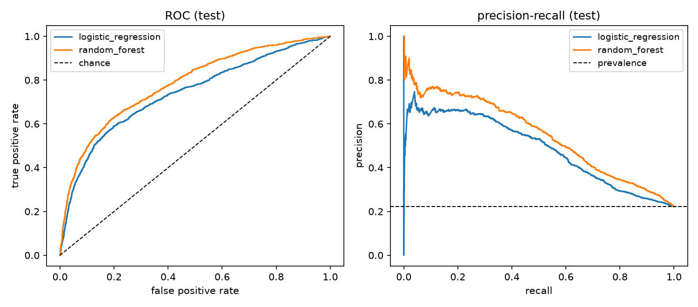

# creditdecide

creditdecide takes a labeled table and turns it into a decision rule that can be explained and
monitored. It checks the data quality first, compares models without leaking test data into
training, benchmarks the best model against the best one-line rule, calibrates the
probabilities, picks which accounts to act on from a capacity or a cost budget, gives reason
codes for every flagged account, puts 95% confidence intervals on the test results, and saves a
checksum-verified model with drift monitoring and a fairness audit. Its data and reporting
layer (the data-quality checks, the gains table, the outcomes join and the drift bins) is DuckDB
SQL, tested against the pandas results, and `creditdecide tableau` writes a run's results as
tables for a Tableau Public dashboard. It ships with a real credit-card default dataset and
also accepts your own CSV.

**The business question on the bundled data:** a card issuer can only act on a limited number
of accounts each month (a call, a payment plan, a lower limit). Which accounts should it act on,
how many of next month's defaults will that reach, how much money will it save, is a model
better than a simple rule, can each decision be explained, and does the rule treat protected
groups comparably?

## What a run produces (credit-card default, test split of 6,002 clients)

The ranges in brackets are 95% bootstrap intervals over the test accounts (see
[Uncertainty](#uncertainty-in-the-results)).

| Question | Answer |
|---|---|
| How good is "do nothing"? | Predicting "no default" for everyone is 77.9% accurate, so accuracy is the wrong measure here. I use ranking, capture and cost instead. |
| Best ranking model? | Random forest, ROC AUC 0.782 [0.768, 0.797], chosen on the validation split. Logistic regression is 0.738, and the random forest's lead of 0.044 [0.033, 0.055] is clear. |
| With capacity to act on 10% of accounts? | It reaches **31.5% [29.0%, 33.8%] of next month's defaulters at 69.9% precision**, 3.15 times better than picking accounts at random. The validation estimate was 31.3%. |
| Is the model better than a simple rule there? | **No.** The rule "two or more months late last month" flags 10.9% and reaches 34.1%; the model at the same volume reaches 33.7%. The difference is −0.4 points [−1.7, +0.9], so the two can't be told apart. At 22.6% of accounts the model is ahead by 3.5 points [1.8, 5.2]. |
| If acting on a good customer costs NT$8,000 and a missed default loses 60% of the balance? | One score cut-off cuts the expected cost by 43.1% against the better of acting on nobody and acting on everybody. A per-account rule that uses each balance cuts it by 63.9%. The gap of 20.8 points [15.2, 27.7] is NT$7.8 million [5.4, 10.3] on the 6,002 test accounts, and the per-account rule saves more in all nine cost scenarios tested. |
| How many defaults should we plan for? | The probabilities are calibrated: **1,337 defaults expected and 1,332 occurred**, a forecast error of +0.4% [−3.5%, +4.6%]. The loss forecast is less certain, −2.7% [−9.6%, +4.6%], because a few large balances carry much of the loss. |
| Why was this account flagged? | Up to four reason codes per flagged account, with measured accuracy. Setting the stated reasons to typical values changes the decision for 100% of flagged accounts, and the top reason alone does it for 82%. "Repayment status last month" is the main reason for 83%. |
| Do we need adverse-action notices? | It depends on the rule. 99.5% of the accounts flagged at the 10% budget are already late, and actions taken because of a delinquency are not adverse action under Regulation B. The per-account cost rule flags **646 customers in good standing**, and a limit cut for them needs specific reasons. |
| Does hyperparameter tuning help? | Barely. Tuning gains 0.001 to 0.007 in cross-validated AUC, all within one standard deviation, and the tuned gradient boosting model matches the default random forest on test (ROC AUC 0.782 for both). The model is limited by the data, not its settings. |
| Is anyone treated very differently? | No group large enough to interpret falls below the four-fifths reference. But age was excluded and the inputs still predict "under 25" with ROC AUC 0.82, and under-25s are flagged at 15.1% vs 8.9% to 10.6% for other ages (their default rate is also higher, 27.7%). |
| Will it keep working? | Every scoring run reports the population stability of each input and of the score. Scoring only clients under 30 is flagged as a moderate shift in credit limits. |

The full write-up, with the industry reasoning behind each choice, is in
[docs/BUSINESS_CASE.md](https://github.com/nsteinle/creditdecide/blob/main/docs/BUSINESS_CASE.md).
Data findings and the verification log are in
[docs/FINDINGS.md](https://github.com/nsteinle/creditdecide/blob/main/docs/FINDINGS.md), and
the generated model card is
[docs/MODEL_CARD.md](https://github.com/nsteinle/creditdecide/blob/main/docs/MODEL_CARD.md).

## Install

```bash
pip install creditdecide            # library and command line
pip install "creditdecide[plot]"    # adds the figures
```

Python 3.10 to 3.13. The dependencies are NumPy, pandas, scikit-learn, skops and DuckDB; no
GPU, database server or internet access is needed at run time.

## Workflow

```bash
creditdecide quality --dataset credit-default                  # 1. check the data
creditdecide run --dataset credit-default --out results/credit --plot   # 2. train, decide, explain, export (~10 s)
creditdecide predict --model-dir results/credit/model \
    --csv results/credit/holdout_test.csv --out results/scored --id-column ID --reasons 4  # 3. score and explain
creditdecide drift --model-dir results/credit/model --csv new_month.csv  # 4. monitor
```

When the outcomes arrive later, in a separate file, join them to the saved decisions:

```bash
creditdecide outcomes --model-dir results/credit/model --scores results/scored/scores.csv \
    --labels labels.csv --id-column ID --out results/outcomes.json
```

For a dashboard, and for questions of your own about the data:

```bash
creditdecide tableau --run-dir results/credit --scored results/scored --out results/tableau
creditdecide sql --dataset credit-default \
    --query 'SELECT EDUCATION, COUNT(*) AS n, AVG("DEFAULT") AS default_rate FROM data GROUP BY ALL ORDER BY ALL'
```

The table is called `data`. Quote the label column as `"DEFAULT"`, because `DEFAULT` is a SQL
keyword. Queries can read only that table: files and the network are out of reach.

Decision policies and rules (binary targets):

```bash
creditdecide run ... --budget 0.10                                         # capacity: act on 10%
creditdecide run ... --cost-fp 8000 --lgd 0.6 --exposure-column BILL_AMT1  # cost: one cut-off
creditdecide run ... --cost-fp 8000 --lgd 0.6 --exposure-column BILL_AMT1 \
    --decision-rule expected_loss                                         # cost: per account
creditdecide run ... --cost-fp 1 --cost-fn 5                               # cost: constant
creditdecide run ... --tune                     # tune by cross-validation (~4 min on 2 cores)
creditdecide run ... --bootstrap 0              # skip the confidence intervals
```

Your own data (a label column plus numeric or declared categorical features):

```bash
creditdecide run --csv loans.csv --target defaulted --positive-label 1 --drop loan_id \
    --categorical region --signed-log balance income --protected age sex --out results/loans
```

Python:

```python
from creditdecide import CREDIT_DEFAULT_SPEC, Config, DecisionPolicy, load_credit_default, \
    load_model, run

res = run(load_credit_default(), CREDIT_DEFAULT_SPEC, Config(seed=0), DecisionPolicy(budget=0.1))
res.decision["test"]                    # capture rate, precision, lift, ...
res.decision["simple_rule_benchmark"]   # the one-line rule the model has to beat
res.calibration["test_calibrated"]      # ECE, Brier, expected vs actual defaults
res.bootstrap                           # 95% intervals for the test results
res.reasons                             # reason codes for flagged test accounts
res.save("results/credit")              # evaluation outputs and the deployable model

model = load_model("results/credit/model")   # checksums and allowed types verified
model.decide(new_df, id_column="ID")         # score, calibrated probability, flag
wide, detail, summary = model.reasons(new_df, id_column="ID")   # reason codes, flagged rows
```

## Outputs

`run` writes metrics for every model and split; `decision.json` (rule, threshold, validation
and test outcomes, simple-rule benchmark, reason-code accuracy); `bootstrap_test.csv` (95%
intervals); `gains_test.csv`; `cost_sensitivity.csv` (both rules, cost policies only);
`calibration_cv.csv` and `calibration_test.csv`; `reasons_test.csv` and
`reasons_test_detail.csv`; `fairness_test.csv`; `tuning.csv` (with `--tune`); `samples.csv`
(one row per example); `holdout_test.csv` (the untouched test rows, for trying `predict`); and
`model/`:

| file | contents |
|---|---|
| `manifest.json` | input schema, decision rule and threshold, calibration map, reason-code factors and reference profile, test metrics, file checksums, library versions |
| `pipeline.skops` | preprocessing and scoring model, in skops format (no pickle) |
| `reference.json` | validation-split distributions for drift monitoring |
| `MODEL_CARD.md` | purpose, data, performance, decision outcome, probabilities, reason codes, uncertainty, fairness, monitoring, limitations |

`predict` writes `scores.csv` (score, calibrated probability, flag) and `drift.csv`. With
`--reasons` it also writes `reasons.csv`, `reasons_detail.csv` and `reasons_summary.json`, and
when the file contains the target it writes `outcomes.json` (realized capture, precision and
calibration compared with the figures at training time). `outcomes` writes the same file from
a separate labels file, and counts the rows that appear on only one side of the join.

`tableau` writes `accounts.csv` (one row per test account: inputs, readable group names, score,
probability, decision, score decile and top reason), `decision.csv`, `gains.csv`,
`calibration.csv`, `models.csv`, `intervals.csv`, `reasons.csv`, `fairness.csv`, `drift.csv`
(with `--scored`) and `tables.json`, which lists each file's columns and row count.

## Design decisions

| Practice | Why |
|---|---|
| Data-quality report before any modeling | duplicates with conflicting labels, undocumented codes and class imbalance change what a good result looks like |
| Group-aware 60/20/20 split, with preprocessing fit on the training rows only | no statistic and no duplicate input crosses from the test split into training |
| Labels used only by the models | a transform that uses the labels leaks the answer into the features |
| Tuning by group cross-validation inside the training split; model, calibration and threshold chosen on validation; test used once | each split has one job, so the test result is a fair estimate of how the rule would do in use |
| Baselines and a one-feature rule always reported, at the model's own volume | a model is only worth deploying if it beats what a simple rule already does |
| Decisions from capacity or explicit costs, with savings measured against the better of two trivial strategies | a score alone doesn't say whom to act on, and beating "do nothing" can still lose to "act on everyone" |
| Calibration chosen by cross-validated log loss with the one-standard-error rule | a correction is only added when it clearly helps; calibration is monotone, so threshold decisions never change |
| Reason codes against the population that just passed, grouped into business factors, with measured accuracy | follows Regulation B comment 9(b)(2)-5, and the CFPB expects explanations of complex models to be accurate |
| Bootstrap intervals on test results, with comparisons made on the same resamples | 6,002 test accounts is one sample, and a difference that is smaller than its noise shouldn't drive a decision |
| Protected attributes excluded by default but always audited, with a proxy check | in US lending, sex and marital status are prohibited bases and age is restricted (ECOA / Regulation B), and leaving them out does not remove the information |
| Model files with checksums, a type allow-list and no pickles | safe to load and to hand to someone else |
| PSI on every input and on the score at each scoring run | the model was fit on one population and is used on later ones |
| Data-quality checks, gains table, outcomes join and drift bins in DuckDB SQL, each tested against the pandas version it replaced | set-based checks read most clearly as SQL, and the tests show the SQL gives the same numbers |
| Random forests fit on all cores but predict on one thread | with several threads the trees' predictions are added in whatever order the threads finish, so reruns could differ in the last bit and a reason with no effect could be listed; on one thread every rerun matches bit for bit |

## Uncertainty in the results

The test split is one sample of customers, so each test figure comes with a 95% interval. The
package redraws the 6,002 test accounts with replacement 1,000 times (accounts with identical
inputs are drawn together), recomputes every figure on each redraw, and reports the middle 95%
of the results. Comparisons, such as model minus rule or one model minus another, are computed
on the same redraws, so a difference gets its own interval. The models, threshold and
calibration are held fixed, so these intervals cover the choice of test customers but not
retraining. Retraining with a different seed, which also changes the split, moves the random
forest's test AUC by an amount of the same order (0.775 to 0.782 over two seeds).

What the intervals change in the conclusions:

- At a 10% budget the model and the simple rule are indistinguishable. Even at the top of the
  interval the model would reach about 12 more defaulters per 6,000 accounts, so the rule is
  the sensible choice at that capacity.
- At larger volumes and for cost decisions the model's advantage is clear: 3.5 points [1.8,
  5.2] more defaulters at 22.6% of accounts, and NT$7.8 million [5.4, 10.3] more saved by the
  per-account rule on the test month.
- For planning, the default count can be quoted to within about 5% and the loss to within
  about 10%.
- The random forest's lead over logistic regression is clear, since its interval excludes
  zero. The tuning gains (0.004 for the random forest) are much smaller than the interval
  widths.

## The SQL layer

The models are Python, and the data around them is SQL. Four parts of the package are DuckDB
queries, kept as readable `.sql` files in
[src/creditdecide/sql](https://github.com/nsteinle/creditdecide/tree/main/src/creditdecide/sql):

| query | what it does |
|---|---|
| `duplicates.sql`, `class_counts.sql`, `undocumented_codes.sql` | the data-quality report: rows that share all inputs, groups whose labels conflict (`GROUP BY ALL`), values outside the documented codes (`ANTI JOIN`) |
| `gains.sql` | the gains table: ranks the test accounts with `ROW_NUMBER()`, cuts them into deciles and accumulates capture and lift with a window |
| `outcomes.sql` | the outcomes join: decisions to labels that arrive later, by ID, with a `FULL OUTER JOIN` so that unmatched rows are counted rather than dropped |
| `psi.sql` | the drift bins: assigns each new value to its reference bin, adds a bin for unseen categories and sums the population stability index |

DuckDB runs inside the Python process and reads the pandas DataFrames in place, so there is no
server and nothing to set up. `tests/test_sql.py` runs each query on the bundled data and
checks it against the pandas code it replaced: the counts, the gains table and the outcomes
match exactly, and the PSI values match to 1e-12 (the bins are summed in a different order).
On these 30,000 rows the queries show correct SQL, not scale; every table here fits in memory
many times over.

## Tableau Public dashboard

`creditdecide tableau` turns a run into flat CSV tables for
[Tableau Public](https://public.tableau.com), which opens text files but not Parquet. The tables
are built by the same SQL layer. [docs/TABLEAU.md](https://github.com/nsteinle/creditdecide/blob/main/docs/TABLEAU.md)
describes a five-panel dashboard built from them: the KPI tiles, the gains chart against random
selection, the reliability diagram, the reasons for flagged accounts, and the flag rate by
protected group.



## Limitations

- There is one bundled dataset (Taiwan, 2005, amounts in NT$). The cost figures are
  illustrative assumptions, which is why every cost run reports a sensitivity table, and the
  cost model assumes that acting prevents the whole loss.
- Reason codes approximate the model by setting one factor at a time to typical values. Their
  accuracy is measured, not guaranteed, and they describe the model, not causes.
- Calibration is fit on one validation sample and should be rechecked as outcomes arrive.
- The confidence intervals cover the choice of test customers only, not retraining or changes
  in the population over time.
- There is no live champion-challenger testing, no real-time serving (batch scoring only) and
  no monotonic constraints on the models.
- PSI uses decile bins, which can understate shifts in heavy-tailed variables (see
  FINDINGS.md).
- With `--tune`, the gradient boosting model depends on the scikit-learn version, because
  scikit-learn 1.8 changed it. Runs without `--tune` give the same results on every supported
  version (FINDINGS.md, verification log).

## Data, citation and license

The code is under the MIT license (`LICENSE`). The bundled data are Yeh, I.-C. (2009), *Default
of Credit Card Clients*, UCI Machine Learning Repository,
[doi:10.24432/C55S3H](https://doi.org/10.24432/C55S3H), CC BY 4.0, with the changes listed in
`DATA_LICENSE.md`. Citation metadata is in `CITATION.cff`, and the release process is in
[docs/DEPLOY.md](https://github.com/nsteinle/creditdecide/blob/main/docs/DEPLOY.md).
